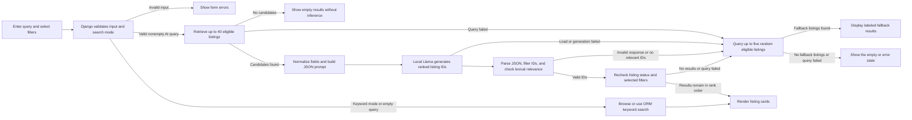
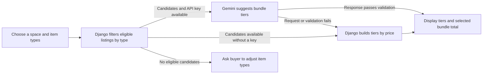
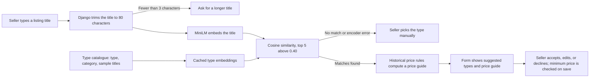

# AI System Design Documentation

## Contents

- [S2.1: AI Workflow Write-Up](#s21-ai-workflow-write-up) · [Listing search](#natural-language-listing-search) · [Bundling](#ai-bundle-builder) · [Pricing suggestions](#pricing-suggestions) · [Photo autofill](#listing-photo-autofill)
- [Guardrails and Error Handling](#guardrails-and-error-handling) · [Search](#search-guardrails) · [Bundling](#bundling-guardrails) · [Pricing](#pricing-guardrails) · [Photo autofill](#photo-autofill-guardrails)
- [S2.2: Architecture Explanation](#s22-architecture-explanation) · [Listing search diagram](#natural-language-listing-search-diagram) · [Bundling diagram](#ai-bundle-builder-diagram) · [Pricing diagram](#pricing-suggestions-diagram)
- [S2.3: Model Selection Rationale](#s23-model-selection-rationale) · [Setup](#setup)
- [Part 3: Evaluation](#part-3-evaluation-of-the-integrated-features) · [S3.1 Inputs](#s31-realistic-app-inputs) · [S3.2 Outputs](#s32-output-evaluation) · [S3.3 Failures](#s33-failure-analysis) · [S3.4 Improvement](#s34-improvement)

## S2.1: AI Workflow Write-Up

Natural-language listing search and the AI Bundle Builder address two main buyer needs in MoveOn. Search helps buyers find listings that match a request, while the Bundle Builder helps them furnish a space and compare sets of items. A locally hosted Llama model powers the primary AI search. Gemini provides optional bundle recommendations alongside a price-based fallback. [Search workflow][search-entry] · [Bundle generation][bundle-generation]

### AI Feature Explanation

#### Natural-Language Listing Search

1. **User input.** Buyers enter a request on the home page or `/listings/` and choose AI mode. The browser sends the query as `q`, sets `search_mode=ai`, and includes the selected filters for price, category, condition, and fulfillment. Buyers use these controls to specify exact constraints such as a maximum price. [Search mode][search-entry] · [Filter form][browse-form]
2. **Input preprocessing.** Django starts with active listings that meet the selected filters. It prioritizes listings whose titles, descriptions, categories, or item types match query terms and fills any remaining slots with recent eligible listings. The candidate pool contains at most 40 listings. The application normalizes whitespace and serializes the query and candidate IDs, titles, category or type labels, prices, conditions, and descriptions as JSON. The payload omits separate seller identity and contact fields. [Candidate selection][search-candidates] · [Model payload][search-payload]
3. **Model.** The local `meta-llama/Llama-3.2-3B-Instruct` model ranks candidates against the buyer's request. Django prepares the input using the Transformers chat template. [Model configuration][ai-settings] · [Local inference][search-generation]
4. **Output generation.** The prompt asks the model to return up to five candidate IDs in a JSON `ids` array ordered by relevance. The array may be empty when there is no suitable match. Django applies the [search validation checks](#search-guardrails) and queries the database for the remaining listings. [Output prompt][search-prompt] · [Final listing query][search-result-query]
5. **User response.** Django preserves the model's relative ordering and renders the listings as cards on the home or browse page. [Search Guardrails](#search-guardrails) explains the empty-result and fallback states. [Result ordering][search-result-query] · [Listing card template][search-result-cards]

#### AI Bundle Builder

1. **User input.** Buyers choose a space and item types in the bundle wizard, such as a bed frame and a desk for a bedroom. The wizard provides the available spaces and item types. [Wizard selections][bundle-wizard]
2. **Input preprocessing.** Django groups active, bundle-eligible listings from other sellers by the selected item types. Each candidate includes its ID, title, price, condition, and description. The application also includes available context such as days until move-out, average completed-sale prices, and benchmark price ranges. [Eligible candidates][bundle-candidates] · [Candidate fields][bundle-payload]
3. **Model.** With `GEMINI_API_KEY` configured, the application uses `gemini-3.6-flash`. The prompt asks Gemini to pick listings for Budget, Best Value, and Premium tiers and provide a short rationale for each tier. [Tier prompt][bundle-prompt] · [Gemini request][bundle-request]
4. **Output generation.** Gemini returns JSON containing the selected listing IDs and rationale for each tier. Django [validates the choices](#bundling-guardrails) and stores the tier suggestions in the session. It computes the bundle total by adding the listing prices of the selected items. [Tier validation][bundle-validation] · [Session cache][bundle-cache] · [Total calculation][bundle-total]
5. **User response.** The bundle page displays the items, total, and available rationale for the selected tier. Buyers can switch tiers or swap items. Django persists the current selection as `BundleItem` records. [Bundle page][bundle-display] · [Selected-item persistence][bundle-items]

#### Pricing Suggestions

1. **User input.** Sellers enter a listing title and can also provide a category, item type, condition, or brand.
2. **Input preprocessing.** The application builds candidate type descriptions from type and category names and representative titles with historical price records. [Type descriptions][pricing-semantic]
3. **Model.** The local `sentence-transformers/all-MiniLM-L6-v2` encoder embeds the seller's query and the type descriptions, then ranks candidate item types by similarity. [Semantic type matching][pricing-semantic]
4. **Output generation.** Pricing rules compute a reference price from historical observations for the matched type, condition, and brand where supported. A seller who has selected a type can also request its price guide directly. [Historical price calculation][pricing-calc] · [Selected-type price endpoint][pricing-preview]
5. **User response.** The seller form displays suggested types and available price guides. Sellers can accept, edit, or decline a price recommendation. [Pricing Guardrails](#pricing-guardrails) covers limited evidence and minimum-price protection. [Type suggestion cards][pricing-form-ui] · [Seller decision and save][pricing-save]

#### Listing Photo Autofill

1. **User input.** Sellers upload listing photos. Analysis starts after the upload completes, and the **Fill details from photos** button can also start it. [Analysis triggers][photo-trigger]
2. **Input preprocessing.** The browser submits the first three photo IDs, or all available IDs if there are fewer than three. The service resizes each image to fit within 1024 by 1024 pixels, converts them to RGB, and prepares the allowed item types and conditions. [Photo selection][photo-selection] · [Image preparation][photo-preparation]
3. **Model.** The application uses `gemini-3.5-flash-lite` to suggest listing details from the images and allowed field values. [Photo model configuration][photo-model]
4. **Output generation.** The model returns structured JSON with suggestions for the title, description, item type ID, and condition. [Field prompt and options][photo-prompt]
5. **User response.** The browser inserts usable suggestions into the editable form. Sellers can review the values and submit the form normally. [Photo Autofill Guardrails](#photo-autofill-guardrails) explains how the browser handles changed photos and existing field values. [Browser autofill][photo-fill]

## Guardrails and Error Handling

### Search Guardrails

- **Input and candidate limits.** `BrowseForm` limits the query to 200 characters. An empty query skips model inference and shows the normal browse results. A missing or invalid search mode defaults to keyword search. An AI query with an empty initial candidate pool shows an empty result without running inference. [Query validation][browse-form] · [Search mode and empty input][search-entry]
- **Model input and generation limits.** The model payload limits titles and category labels to 200 characters each, condition values to 50 characters, and descriptions to 1,000 characters. Generation is limited to 128 new tokens. Timing starts after model loading and tokenization. The application passes `max_time=30` and checks elapsed generation time when the model call returns. [Field limits][search-payload] · [Generation timing][search-generation]
- **Result validation.** Django parses the `ids` array, discards noninteger, duplicate, and noncandidate IDs, and keeps at most five. Malformed JSON, an invalid response structure, or a nonempty array containing no valid IDs enters the corresponding error path. Valid IDs pass through a lexical relevance check based on query terms and synonym groups. Django then rechecks that the listings remain active and satisfy the selected filters. [ID parsing][search-parse] · [Lexical relevance check][search-relevance] · [Database recheck][search-result-query]
- **No results and fallback.** If the model call fails, the ranking is unusable, or a candidate or result query fails, Django attempts to display up to five randomly selected listings that meet the filters. The page labels these as fallback results. If the fallback query fails or returns no listings, the page displays the corresponding message. [Fallback query and messages][search-fallback] · [Fallback notice][search-fallback-ui]

### Bundling Guardrails

- **Result validation.** Each accepted listing ID must belong to the candidate set for the corresponding item type. Every tier needs at least one usable item. If some types have no eligible listings, the page reports that categories were skipped. If none of the selected types has an eligible listing, the wizard asks the buyer to adjust the selection. [Tier ID validation][bundle-validation] · [Empty candidate handling][bundle-empty]
- **Request limits and fallback.** The Gemini request has a 10-second timeout and SDK retries are disabled. When the key is missing, the call fails, or the response fails validation, the application builds tiers from the lowest-priced, middle-ranked, and highest-priced listings in each item type. The page labels the recommendation source. Changing tiers loads the IDs saved in the session, and a manual swap checks the eligibility of the replacement listing. [Request settings][bundle-request] · [Price-based fallback][bundle-fallback] · [Swap validation][bundle-swap]

### Pricing Guardrails

- **Match and evidence limits.** The type suggestion endpoint reads the first 80 characters of the title and asks for more text if fewer than three characters remain. It returns up to five types that meet the 0.40 similarity threshold. The price guide uses historical price observations from 2023 outside the local market. Sparse groups receive an evidence warning. The application omits the corresponding estimate when it lacks supporting data. [Title validation][pricing-type-view] · [Similarity cutoff][pricing-similarity] · [Pricing evidence][pricing-calc]
- **Saving and fallback.** On submission, Django recalculates the reference price and records the seller's decision. It checks the seller's minimum price before applying an accepted recommendation. If semantic encoding fails, the interface prompts the seller to choose the item type manually. [Minimum price and save][pricing-save] · [Encoder error handling][pricing-type-view]

### Photo Autofill Guardrails

- **Upload and analysis checks.** The upload endpoint rejects empty, oversized, unreadable, or unsupported images, with a limit of 5 MiB per file. The analysis endpoint requires a signed-in user, validates ownership and the submitted IDs, and accepts one to three uploaded photos. A seller with a URL-only photo can upload the image or enter the details manually. A cache-based limit allows five analyses per user in a 600-second window. [Upload validation][photo-upload] · [Analysis checks and rate limit][photo-analysis]
- **Request limits and field validation.** Each Gemini attempt has a 15-second timeout and a 512-token output limit. The application retries once on `ServiceUnavailable`. For recognizable items, the service trims titles and descriptions and clears invalid item type or condition values. Sellers can enter the details manually if analysis fails or produces no usable suggestions. [Request and retry][photo-request] · [Field validation][photo-validate]
- **Autofill and changed photos.** After a successful response, the browser compares the complete current photo ID sequence with the sequence captured before the request. A change in length or in any ID position skips autofill and prompts the seller to analyze the photos again. Uploading, removing, or reordering photos updates the ID list immediately. The browser fills empty fields by default. If all four target fields already contain values, it asks for confirmation before replacing them. [Photo comparison][photo-change] · [Photo ID updates][photo-ids] · [Field updates][photo-fill]

## S2.2: Architecture Explanation

### Natural-Language Listing Search Diagram

**AI model** `meta-llama/Llama-3.2-3B-Instruct`



[Search Guardrails](#search-guardrails) describes the query limits, result checks, and random-listing fallback. [Search request handling][search-entry] · [Model ranking][search-rank]

### AI Bundle Builder Diagram

**AI model** `gemini-3.6-flash`



[Bundling Guardrails](#bundling-guardrails) describes tier validation, the request timeout, and the price-based fallback. [Generation and fallback][bundle-generation]

### Pricing Suggestions Diagram

**AI model** `sentence-transformers/all-MiniLM-L6-v2` (local)



[Pricing Guardrails](#pricing-guardrails) describes the title limits, similarity threshold, sparse-evidence warning, and manual fallback. [Type matching][pricing-semantic] · [Price calculation][pricing-calc]

## S2.3: Model Selection Rationale

### Natural-Language Listing Search

MoveOn uses `meta-llama/Llama-3.2-3B-Instruct` for local natural-language listing search. A6 evaluated a 40-listing catalog with eight labeled queries and prioritized strict output structure, usable nDCG@5, and median generation time in that order. The zero-shot Llama configuration produced valid structured responses on all eight queries, reached 0.483 usable nDCG@5, and had a median generation time of 3.33 seconds. `Qwen/Qwen3-1.7B` also met the structure requirement on all eight queries with eight prompt examples, reaching 0.458 usable nDCG@5 and a 5.24-second median. The one-shot `microsoft/Phi-4-mini-instruct` configuration met the requirement on six queries, with 0.433 usable nDCG@5 and a 6.26-second median. A7 provides a separate text-extraction comparison in which Qwen3 4B, Phi-4 mini, and Llama scored 7.68, 7.35, and 6.41 respectively. The team set the scoring criteria and used AI-assisted scoring with targeted review. The A6 comparison directly measures ranking a set of listings, which is the task the application needs. Llama runs locally and returns ranked IDs that Django can validate and render as listing cards. [A6 selection criteria][a6-findings] · [A6 n-shot results][a6-summary] · [A7 extraction results][a7-extraction] · [A7 scoring method][a7-scoring]

### AI Bundle Builder

MoveOn uses `gemini-3.6-flash`, a hosted multimodal model available through the Gemini Developer API free tier, to recommend bundle tiers from the candidate listings' prices, conditions, descriptions, and available move-out context. Its text input and structured output capabilities fit the wizard's need for candidate IDs and short rationales. The A7 purchase-advice results for Qwen3 4B and Mistral-Nemo provide reference points for local text models. The application also implements price-based tier generation as an alternative. The Best Value prompt asks Gemini to weigh price against condition and explain its selection. Django can then validate the IDs, calculate the total using listing prices, and show the tier choices in the buyer's wizard. [Gemini Developer API pricing](https://ai.google.dev/gemini-api/docs/pricing) · [Bundle prompt][bundle-prompt] · [A7 purchase-advice comparison][a7-purchase] · [Gemini 3.6 Flash specifications](https://ai.google.dev/gemini-api/docs/models/gemini-3.6-flash) · [Bundling design notes](https://github.com/AnniecTW/6-moveon/blob/970ceddefd34c18aaefcf361dafa46f807e2ba0d/docs/notes/weekly_progress_updates/wk3_note_srinath.md#L39)

### Pricing Suggestions

MoveOn uses the local `sentence-transformers/all-MiniLM-L6-v2` encoder to match seller titles to item types supported by historical records. The lexical candidate selection used for the A6 search workflow provides a matching baseline. Embeddings let the pricing workflow compare seller wording with the descriptions in the type catalog. Since that catalog is relatively stable, Django can cache its embeddings and encode only the new seller input on repeat queries. This fits the listing form because sellers can confirm the proposed type before the application computes a traceable price guide from the type, condition, and historical observations. The implementation tests exercised semantic matching with a controlled encoder and checked the form's pricing path.

This feature applies the A8 retrieval pipeline inside the app. Each item type becomes a short document made from the type name, the category, and up to eight representative historical titles. The documents and the seller's query are embedded with normalized sentence-transformer vectors and ranked by cosine similarity. The top five above a 0.40 threshold are returned. As in A8, retrieval is kept separate from the answer: the matched type selects historical observations, and the price guide is computed from those observations, not generated by a model. The [Part 3 evaluation](#pricing-type-suggestions) shows the threshold rejecting junk and out-of-catalogue titles. [Type matching][pricing-semantic] · [Pricing implementation notes][pricing-notes]

### Listing Photo Autofill

MoveOn uses `gemini-3.5-flash-lite`, a hosted multimodal model available through the Gemini Developer API free tier, to suggest a title, description, item type, and condition from listing photos and the allowed form options. Qwen3 4B and Phi-4 mini provide A7 reference points for structured extraction from text. Photo autofill adds visual input to that task. Gemini's multimodal design allows the service to send images with the field options and request structured output in the same call. Google positions Flash-Lite for low-latency, high-throughput processing, which fits the short fields needed by the listing form. The feature shares the Gemini SDK and API key with Bundling. Django validates the proposed values and the seller can edit them before submitting the listing. [Gemini Developer API pricing](https://ai.google.dev/gemini-api/docs/pricing) · [Photo model request][photo-request] · [A7 text extraction results][a7-extraction] · [Gemini multimodal design](https://blog.google/innovation-and-ai/technology/ai/google-gemini-ai/) · [Flash-Lite model specifications](https://docs.cloud.google.com/gemini-enterprise-agent-platform/models/gemini/3-5-flash-lite) · [Flash-Lite release notes](https://blog.google/innovation-and-ai/models-and-research/gemini-models/gemini-3-6-flash-3-5-flash-lite-3-5-flash-cyber/)

### Setup

The project README explains environment setup, server startup, and model downloads. [AI feature setup][ai-setup]

Local search uses `LOCAL_LLM_MODEL_ID` and `HF_TOKEN`. Bundling and photo autofill share `GEMINI_API_KEY`. [AI settings][ai-settings]

## Part 3: Evaluation of the Integrated Features

Part 3 evaluates the two features that run on local models: natural-language listing search (`meta-llama/Llama-3.2-3B-Instruct`) and pricing type suggestions (`sentence-transformers/all-MiniLM-L6-v2`). The [`evaluate_ai`](marketplace/management/commands/evaluate_ai.py) management command runs every case through application code, not a notebook. Search cases call `browse_context`, the same function the home and browse pages render, so candidate selection, Llama ranking, the relevance gate, the database recheck, and the random fallback all apply. Pricing cases call `suggest_types` and `recommend` in the same way as the seller endpoint. Raw results are in [`docs/A9-part3/`](docs/A9-part3/).

**Setup.** The command seeds the 40-listing A6 catalogue ([`llm-test/listings.json`](llm-test/listings.json)) into a throwaway database with the original IDs, so the A6 gold labels ([`llm-test/gold_labels.json`](llm-test/gold_labels.json)) still apply. Search quality uses the A6 metrics: nDCG@5 with gain 2 for relevant listings and 1 for acceptable ones, and Recall@5 of relevant listings. A fallback result counts as 0, because random listings are not AI recommendations. Latency is wall time for the whole Django request on an Apple M4 laptop (16 GB, MPS, bfloat16), with the model already loaded. All runs use greedy decoding.

### S3.1: Realistic App Inputs

| Case | Feature | Input | Why it is realistic |
|---|---|---|---|
| S1 | Search | "I want to buy some decoratives for the living room" | Vague, style-oriented request with a nonstandard word (A6 gold query) |
| S2 | Search | "need something blue to complement my bedside table" | Colour and room constraint, conversational phrasing (A6) |
| S3 | Search | "setting up a study corner in my dorm, budget under $50" | Typical student move-in request with a budget written in the text (A6) |
| S4 | Search | "something to watch movies on in my apartment" | Describes a use rather than naming an item (A6) |
| S5 | Search | "I need to heat up food quickly" | Pure need, no product words (A6) |
| S6 | Search | "make my bedroom darker so I can sleep in" | Indirect need; the answer (blackout curtains) shares no words with the query (A6) |
| S7 | Search | "storage for my books and stuff" | Casual phrasing (A6) |
| S8 | Search | "comfortable seating for when friends visit" | Category described by purpose (A6) |
| S9 | Search | "comfy couch for my apartment" + `max_price=60` filter | Slang plus a structured price filter from the browse form |
| S10 | Search | "snowboard for winter break" | Request with no matching inventory |
| P1 | Pricing | "IKEA Malm 6-drawer dresser, white" (Good, brand IKEA) | Common branded furniture title |
| P2 | Pricing | "Mini fridge for dorm room" (Like New) | Most common dorm appliance |
| P3 | Pricing | "LED desk lamp with USB port" (Good) | Specific product wording |
| P4 | Pricing | "Queen size memory foam mattress topper" (Good) | Bedding item close to category boundaries |
| P5 | Pricing | "Xbox wireless controller" (Good, Microsoft) | Item type absent from the 2023 price data |
| P6 | Pricing | "asdf qwerty" | Junk input |

### S3.2: Output Evaluation

#### Listing search (after the S3.4 improvement)

| Case | Expected behavior | Actual output (shown to user) | Quality notes | Latency |
|---|---|---|---|---|
| S1 | Vases, wall art, prints, pillow, planter | Linen Curtain Panels, Patterned Wool Rug, Glass Coffee Table, Gray Rug, Desk Lamp | nDCG 0.35. Three acceptable items, but none of the five labelled relevant items. The model read "decor" as furnishings. | 10.4 s |
| S2 | Navy lamp, blue blanket, blue planter, vase, nightstand | Navy Table Lamp, Oak Desk, Blue Throw Blanket | nDCG 0.51. The two blue items are correct; Oak Desk is off-target. | 7.4 s |
| S3 | Desk, desk lamp, small bookshelf, monitor, shelf ≤ $50 | Small Bookshelf | nDCG 0.34. Correct but thin: the gate removed four weak model picks (curtains, pillow, coffee table, navy lamp). | 8.0 s |
| S4 | TVs and speakers | Television | nDCG 0.34. Correct top result, but the model repeated ID 9 five times; ID de-duplication left one card. | 8.1 s |
| S5 | Both microwaves | Countertop Microwave, Microwave | nDCG 0.87, recall 1.0. The gate removed the model's TV, lamp, and blanket padding. | 8.4 s |
| S6 | Blackout Curtains | Labelled random fallback | nDCG 0. The model returned `{"ids":[]}` and missed the only relevant listing. | 7.1 s |
| S7 | Bookshelves and shelving | Tall Shelving Unit | nDCG 0.39. Correct, but the gate also dropped two valid bookshelves. | 8.1 s |
| S8 | Sofas, loveseat, rocking chair | Compact Loveseat, Blue Sofa, Rocking Chair | nDCG 0.83, recall 0.75. Best ranking; the gate removed curtain and bookshelf padding. | 8.1 s |
| S9 | Only sofas ≤ $60 (Compact Loveseat; Blue Sofa is $65) | Compact Loveseat, Throw Pillow, Desk Lamp, Rustic Wood Coffee Table, Linen Curtain Panels | The price filter worked (Blue Sofa excluded). The top result is right, but four weak items passed the gate (see F3). | 7.0 s |
| S10 | No AI matches; labelled fallback | Model `{"ids":[]}` → labelled random fallback | Correct, graceful behavior. | 6.9 s |

**Summary (8 A6 gold queries).** The mean user-visible nDCG@5 is 0.454 and mean Recall@5 is 0.36. The model's own ranking before the gate scores 0.592 nDCG@5, compared with 0.483 for the same model in A6. The app payload adds item-type labels such as "Furniture / Sofa", and it uses the revised prompt. Two of the ten searches fell back: S10 by design and S6 because of a model miss. JSON output was valid in 10 of 10 cases after the improvement. The median request latency is 8.0 s. Loading the model takes about 10–18 s from the local cache and 246 s on the very first run, which includes the 6 GB download. A repeat run produced identical results ([`results_after_repeat.json`](docs/A9-part3/results_after_repeat.json)).

Latency is the main weakness for a web request. The M4 needs about 8 s per search, compared with A6's 3.33 s median on a T4 GPU, because the prompt carries about 2,900 tokens for 40 listings. The `max_time=30` cap and the fallback keep the page from hanging.

#### Pricing type suggestions

| Case | Expected behavior | Actual output (top suggestion) | Quality notes | Latency |
|---|---|---|---|---|
| P1 | Furniture / Dresser with a price guide | Furniture / Dresser (similarity 0.50), $100.00 | Correct type. The price comes from only 1 historical observation, so it is graded `VERY_LOW` and the UI shows the sparse-evidence warning. | 0.01 s |
| P2 | Appliances / Refrigerator | Appliances / Refrigerator (0.65), $67.00 | Correct and confident match. Price based on 2 observations (`VERY_LOW`). | 0.01 s |
| P3 | Home Decor / Lamp & Lighting | Lamp & Lighting (0.43), $22.50, range $15.75–$73.75 | Correct, with 44 observations (`LOW`). Similarity is close to the 0.40 cut-off. | 0.02 s |
| P4 | Bedding type | Bedding & Bath / Pillow & Bedding Accessories (0.54), $27.00 | Reasonable nearest type; no mattress-specific type exists. 9 observations. | 0.01 s |
| P5 | No reliable type → manual choice | No suggestion | Correct abstention. The 2023 price data has no gaming accessories. | 0.29 s |
| P6 | No suggestion | No suggestion | Junk input is rejected by the 0.40 threshold. | 0.01 s |

The first pricing call after startup takes 2.9 s while the encoder and the type-catalogue embeddings load. Later calls take 10–300 ms. Pricing correctly matched every input that had matching historical data and abstained on the two that did not. Its weakness is thin evidence: three of the four matched types have fewer than 10 observations.

### S3.3: Failure Analysis

**F1. Every AI search fell back to random listings (before the fix).** In the first evaluation run, 10 of 10 searches showed the "No relevant listings found" fallback, giving a user-visible nDCG@5 of 0.000. The cause was the lexical relevance gate in [`marketplace/local_llm.py`](marketplace/local_llm.py) (`_gate_ranked_ids`). It required every non-stop-word in the query to appear in the listing text. Natural phrasing contains words such as "something", "complement", "quickly", or "decoratives" that never appear in a listing, so every model pick was rejected. The unit tests did not catch this because they used short keyword queries such as "bathroom cleaning".

**F2. The model copied the prompt's example IDs (before the fix).** For 8 of 10 queries, including "snowboard for winter break", Llama's answer included IDs 19 and 13, and for seven of them the answer began with `[19,13]`. Those IDs came from the system prompt's format example (`for example {"ids":[19,13]}`), and in the A6 catalogue they are Wall Art Set and Decorative Vase Set. A 3B model with a 2,900-token prompt anchors on literal values in its instructions. The model's own ranking quality dropped to 0.283 nDCG@5, against 0.483 for the same model in A6.

**F3. A broad synonym group lets weak picks through (remaining).** After the fix, "comfy couch for my apartment" (S9) shows Throw Pillow, Desk Lamp, Coffee Table, and Curtains after the correct loveseat. "couch" belongs to the broad decor group in `_RELEVANCE_GROUPS`, which also contains lamp, table, rug, and shelf. Any furnishing therefore satisfies the requirement. S1 ("decoratives") has the same problem. Llama also pads lists to five even though the prompt tells it not to.

**F4. Semantic misses and degenerate output (remaining).** For "make my bedroom darker so I can sleep in" (S6), Llama returned an empty list even though Blackout Curtains describes exactly that need. For S4, it returned `[9,9,9,9,9]`. In two earlier runs, the output for S3/S4 stopped after `{"ids` or `{"ids": [9, 9, 9, 9`. The JSON guardrails handled all of these: duplicates are removed, malformed JSON goes to the labelled fallback, and the page never breaks. They remain quality limits of a 3B model run greedily on MPS. We have not confirmed why the output was truncated. It did not reproduce in a direct test or in the two final runs.

### S3.4: Improvement

We made two targeted changes and measured each with the same ten cases ([before](docs/A9-part3/results_before.json) → [prompt fix](docs/A9-part3/results_after_prompt.json) → [prompt + gate fix](docs/A9-part3/results_after.json)).

1. **Prompt (fixes F2).** In `_build_messages`, the example `{"ids":[19,13]}` was replaced with a description of the schema that contains no concrete IDs: "an ids array whose items are the integer id values of the selected candidate_listings".
2. **Relevance gate (fixes F1).** `_gate_ranked_ids` now keeps a model pick when it matches *at least one* query concept, instead of all of them. `_tokens` folds simple plurals ("decoratives" → "decorative"), and filler words ("something", "stuff", "up", "make" …) were added to the stop-word list. Unrelated picks are still rejected, as the existing "bathroom cleaning" tests require. A new regression test, `test_relevance_gate_keeps_match_when_query_has_extra_words`, fails on the old code and passes on the new code.

| Metric (8 gold queries; fallback rate over all 10 cases) | Before | Prompt fix only | Prompt + gate fix |
|---|---:|---:|---:|
| Searches that fell back to random listings | 10 / 10 | 10 / 10 | **2 / 10** (S10 by design, S6 model miss) |
| User-visible nDCG@5 | 0.000 | 0.000 | **0.454** |
| User-visible Recall@5 | 0.000 | 0.000 | **0.360** |
| Model ranking nDCG@5 before the gate | 0.283 | 0.467 | **0.592** |
| Queries where the model returned copied IDs 19/13 | 8 | 0 | 0 |
| Median request latency | 7.6 s | 8.1 s | 8.0 s |

**Why it helped.** The prompt fix restored the model's real ranking ability: its quality rose above the A6 baseline, and it now correctly returns `[]` for the snowboard query. Because of the gate, users saw none of this until the second fix. With the gate change, AI results reach the page for 8 of 10 queries while still filtering padding. For example, in S5 it removed the TV, lamp, and blanket after the two microwaves. Latency did not change, because both fixes cost nothing at inference time.

**Next improvement before deployment.** F3 shows the trade-off of a lenient lexical gate. We would replace it with a semantic gate. It would reuse the `all-MiniLM-L6-v2` encoder already loaded for pricing (our A8 embedding work) to drop picks whose query–listing cosine similarity falls below a tuned threshold. We would also pass the parsed budget as a `max_price` filter, and shorten descriptions in the payload to cut latency.

### Reproducing the Evaluation

```bash
export DATABASE_PATH=data/eval.sqlite3   # throwaway database; data/ is gitignored
python manage.py migrate
python manage.py sync_pricing_taxonomy
python manage.py evaluate_ai --seed --label after   # --seed only on the first run
```

The command needs `HF_TOKEN` in `.env` for the gated Llama model. Each run writes `docs/A9-part3/results_<label>.json` with the raw model output, the IDs shown, the metrics, and the timings for every case.

[search-entry]: https://github.com/AnniecTW/6-moveon/blob/523e484f4e4af3a09bc7cafaa5c9c2cdacb5dbda/marketplace/browse.py#L149
[bundle-generation]: https://github.com/AnniecTW/6-moveon/blob/523e484f4e4af3a09bc7cafaa5c9c2cdacb5dbda/bundles/services.py#L31
[browse-form]: https://github.com/AnniecTW/6-moveon/blob/523e484f4e4af3a09bc7cafaa5c9c2cdacb5dbda/marketplace/forms.py#L48
[search-candidates]: https://github.com/AnniecTW/6-moveon/blob/523e484f4e4af3a09bc7cafaa5c9c2cdacb5dbda/marketplace/browse.py#L85
[search-payload]: https://github.com/AnniecTW/6-moveon/blob/523e484f4e4af3a09bc7cafaa5c9c2cdacb5dbda/marketplace/local_llm.py#L86
[ai-settings]: https://github.com/AnniecTW/6-moveon/blob/523e484f4e4af3a09bc7cafaa5c9c2cdacb5dbda/moveon/settings/base.py#L34
[search-generation]: https://github.com/AnniecTW/6-moveon/blob/523e484f4e4af3a09bc7cafaa5c9c2cdacb5dbda/marketplace/local_llm.py#L222
[search-prompt]: https://github.com/AnniecTW/6-moveon/blob/523e484f4e4af3a09bc7cafaa5c9c2cdacb5dbda/marketplace/local_llm.py#L145
[search-result-query]: https://github.com/AnniecTW/6-moveon/blob/523e484f4e4af3a09bc7cafaa5c9c2cdacb5dbda/marketplace/browse.py#L191
[search-result-cards]: https://github.com/AnniecTW/6-moveon/blob/523e484f4e4af3a09bc7cafaa5c9c2cdacb5dbda/templates/marketplace/partials/_results.html#L22
[bundle-wizard]: https://github.com/AnniecTW/6-moveon/blob/523e484f4e4af3a09bc7cafaa5c9c2cdacb5dbda/bundles/views.py#L145
[bundle-candidates]: https://github.com/AnniecTW/6-moveon/blob/523e484f4e4af3a09bc7cafaa5c9c2cdacb5dbda/bundles/services.py#L86
[bundle-payload]: https://github.com/AnniecTW/6-moveon/blob/523e484f4e4af3a09bc7cafaa5c9c2cdacb5dbda/bundles/services.py#L118
[bundle-prompt]: https://github.com/AnniecTW/6-moveon/blob/523e484f4e4af3a09bc7cafaa5c9c2cdacb5dbda/bundles/services.py#L144
[bundle-request]: https://github.com/AnniecTW/6-moveon/blob/523e484f4e4af3a09bc7cafaa5c9c2cdacb5dbda/bundles/services.py#L201
[bundle-validation]: https://github.com/AnniecTW/6-moveon/blob/523e484f4e4af3a09bc7cafaa5c9c2cdacb5dbda/bundles/services.py#L220
[bundle-cache]: https://github.com/AnniecTW/6-moveon/blob/523e484f4e4af3a09bc7cafaa5c9c2cdacb5dbda/bundles/views.py#L22
[bundle-total]: https://github.com/AnniecTW/6-moveon/blob/523e484f4e4af3a09bc7cafaa5c9c2cdacb5dbda/bundles/views.py#L381
[bundle-display]: https://github.com/AnniecTW/6-moveon/blob/523e484f4e4af3a09bc7cafaa5c9c2cdacb5dbda/templates/bundles/builder.html#L26
[bundle-items]: https://github.com/AnniecTW/6-moveon/blob/523e484f4e4af3a09bc7cafaa5c9c2cdacb5dbda/bundles/views.py#L300
[pricing-semantic]: https://github.com/AnniecTW/6-moveon/blob/523e484f4e4af3a09bc7cafaa5c9c2cdacb5dbda/marketplace/pricing/semantic.py#L48
[pricing-calc]: https://github.com/AnniecTW/6-moveon/blob/523e484f4e4af3a09bc7cafaa5c9c2cdacb5dbda/marketplace/pricing/initial.py#L105
[pricing-preview]: https://github.com/AnniecTW/6-moveon/blob/523e484f4e4af3a09bc7cafaa5c9c2cdacb5dbda/marketplace/views.py#L361
[pricing-form-ui]: https://github.com/AnniecTW/6-moveon/blob/523e484f4e4af3a09bc7cafaa5c9c2cdacb5dbda/templates/marketplace/listing_form.html#L123
[pricing-save]: https://github.com/AnniecTW/6-moveon/blob/523e484f4e4af3a09bc7cafaa5c9c2cdacb5dbda/marketplace/forms.py#L251
[photo-trigger]: https://github.com/AnniecTW/6-moveon/blob/523e484f4e4af3a09bc7cafaa5c9c2cdacb5dbda/templates/marketplace/listing_form.html#L324
[photo-selection]: https://github.com/AnniecTW/6-moveon/blob/523e484f4e4af3a09bc7cafaa5c9c2cdacb5dbda/templates/marketplace/listing_form.html#L255
[photo-preparation]: https://github.com/AnniecTW/6-moveon/blob/523e484f4e4af3a09bc7cafaa5c9c2cdacb5dbda/marketplace/image_analysis.py#L27
[photo-model]: https://github.com/AnniecTW/6-moveon/blob/523e484f4e4af3a09bc7cafaa5c9c2cdacb5dbda/marketplace/image_analysis.py#L15
[photo-prompt]: https://github.com/AnniecTW/6-moveon/blob/523e484f4e4af3a09bc7cafaa5c9c2cdacb5dbda/marketplace/image_analysis.py#L60
[photo-fill]: https://github.com/AnniecTW/6-moveon/blob/523e484f4e4af3a09bc7cafaa5c9c2cdacb5dbda/templates/marketplace/listing_form.html#L292
[search-parse]: https://github.com/AnniecTW/6-moveon/blob/523e484f4e4af3a09bc7cafaa5c9c2cdacb5dbda/marketplace/local_llm.py#L57
[search-relevance]: https://github.com/AnniecTW/6-moveon/blob/523e484f4e4af3a09bc7cafaa5c9c2cdacb5dbda/marketplace/local_llm.py#L124
[search-fallback]: https://github.com/AnniecTW/6-moveon/blob/523e484f4e4af3a09bc7cafaa5c9c2cdacb5dbda/marketplace/browse.py#L223
[search-fallback-ui]: https://github.com/AnniecTW/6-moveon/blob/523e484f4e4af3a09bc7cafaa5c9c2cdacb5dbda/templates/marketplace/partials/_results.html#L3
[bundle-empty]: https://github.com/AnniecTW/6-moveon/blob/523e484f4e4af3a09bc7cafaa5c9c2cdacb5dbda/bundles/views.py#L207
[bundle-fallback]: https://github.com/AnniecTW/6-moveon/blob/523e484f4e4af3a09bc7cafaa5c9c2cdacb5dbda/bundles/services.py#L259
[bundle-swap]: https://github.com/AnniecTW/6-moveon/blob/523e484f4e4af3a09bc7cafaa5c9c2cdacb5dbda/bundles/views.py#L319
[pricing-type-view]: https://github.com/AnniecTW/6-moveon/blob/523e484f4e4af3a09bc7cafaa5c9c2cdacb5dbda/marketplace/views.py#L382
[pricing-similarity]: https://github.com/AnniecTW/6-moveon/blob/523e484f4e4af3a09bc7cafaa5c9c2cdacb5dbda/marketplace/pricing/semantic.py#L74
[photo-upload]: https://github.com/AnniecTW/6-moveon/blob/523e484f4e4af3a09bc7cafaa5c9c2cdacb5dbda/marketplace/views.py#L524
[photo-analysis]: https://github.com/AnniecTW/6-moveon/blob/523e484f4e4af3a09bc7cafaa5c9c2cdacb5dbda/marketplace/views.py#L605
[photo-request]: https://github.com/AnniecTW/6-moveon/blob/523e484f4e4af3a09bc7cafaa5c9c2cdacb5dbda/marketplace/image_analysis.py#L80
[photo-validate]: https://github.com/AnniecTW/6-moveon/blob/523e484f4e4af3a09bc7cafaa5c9c2cdacb5dbda/marketplace/image_analysis.py#L98
[photo-change]: https://github.com/AnniecTW/6-moveon/blob/523e484f4e4af3a09bc7cafaa5c9c2cdacb5dbda/templates/marketplace/listing_form.html#L287
[photo-ids]: https://github.com/AnniecTW/6-moveon/blob/523e484f4e4af3a09bc7cafaa5c9c2cdacb5dbda/static/marketplace/listing_photos.js#L51
[search-rank]: https://github.com/AnniecTW/6-moveon/blob/523e484f4e4af3a09bc7cafaa5c9c2cdacb5dbda/marketplace/local_llm.py#L249
[a6-findings]: https://github.com/AnniecTW/6-moveon/blob/523e484f4e4af3a09bc7cafaa5c9c2cdacb5dbda/llm-test/Part-1.2_Study-results_N-shot-prompt-engineering/findings.txt#L3
[a6-summary]: https://github.com/AnniecTW/6-moveon/blob/523e484f4e4af3a09bc7cafaa5c9c2cdacb5dbda/llm-test/Part-1.2_Study-results_N-shot-prompt-engineering/summary.csv#L2
[a7-extraction]: https://github.com/AnniecTW/6-moveon/blob/523e484f4e4af3a09bc7cafaa5c9c2cdacb5dbda/docs/A7-part1/output/summary.csv#L41
[a7-scoring]: https://github.com/AnniecTW/6-moveon/blob/523e484f4e4af3a09bc7cafaa5c9c2cdacb5dbda/docs/A7-part1/system_design.md#L14
[a7-purchase]: https://github.com/AnniecTW/6-moveon/blob/523e484f4e4af3a09bc7cafaa5c9c2cdacb5dbda/docs/A7-part1/system_design.md#L98
[pricing-notes]: https://github.com/AnniecTW/6-moveon/blob/523e484f4e4af3a09bc7cafaa5c9c2cdacb5dbda/docs/pricing/implementation_notes.md#L37
[ai-setup]: https://github.com/AnniecTW/6-moveon/blob/523e484f4e4af3a09bc7cafaa5c9c2cdacb5dbda/README.md#L88
