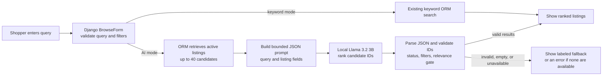

# AI System Design Documentation

## AI Workflow Explanation

The main AI feature is natural-language listing search on the home page and
`/listings/`. Keyword search remains available and is the default. AI search runs
locally with the Hugging Face model `meta-llama/Llama-3.2-3B-Instruct`.

For an AI search, Django validates the query and filters, selects up to 40 active
listings, and sends the query plus limited listing details to the local model.
The candidate pool favors lexical matches and fills remaining slots with recent
eligible listings. The model returns up to five listing IDs as JSON. Django
checks the IDs against the candidate set, rechecks listing status and filters,
and applies a lexical relevance gate before showing results. Users can use the
existing filters for exact price and category constraints.

The query is limited to 200 characters. The prompt contains at most 40 listings;
titles and categories are limited to 200 characters and descriptions to 1,000.
Seller details, contact information, and images are not sent to the search
model. Generation is capped at 128 new tokens.

### Other AI Features

- **AI Bundle Builder:** Gemini 3.6 Flash optionally ranks eligible listings
  into Budget, Best Value, and Premium tiers. If the API is unavailable, the
  builder uses a price-based heuristic.
- **Listing photo autofill:** An optional Gemini 3.5 Flash Lite call suggests a
  title, description, category, and condition from up to three uploaded photos.
  Images are checked and resized to at most 1,024 pixels before analysis. The
  seller reviews and edits suggestions; manual entry remains available.
- **Pricing suggestions:** `all-MiniLM-L6-v2` suggests similar item types. The
  price guide then uses historical observed-price data and
  shows when the evidence is limited. Sellers choose whether to use it.

The homepage search is the primary local-model feature. Photo autofill and
bundling are optional API-backed additions.

## Model Selection Rationale

We chose Llama 3.2 3B primarily from the A6 search experiment, which used a
40-listing catalogue and eight labeled queries. The decision rule prioritized
valid structured output, then usable nDCG@5, then median latency. The selected
zero-shot setup reached 100% strict structure compliance, 0.483 usable nDCG@5,
and 3.33-second median generation latency (4.04 seconds at p95). Zero-shot also avoids
the extra prompt examples. These results favored Llama for this search flow's
combination of ranking quality, reliable ID output, and latency.

A7 gives a broader performance check: across its five task types, Llama 3.2 3B
had a 7.43/10 mean assisted score, 3.44-second median generation latency, and
22.55 output tokens per second. A7's structured extraction score was 6.41/10,
so it does not show Llama as the best model for extraction; Qwen3 4B scored
7.68/10 and Phi-4 mini 7.35/10 on that task. We rely more on A6 for the search
choice because it directly tested listing retrieval and ranking. Both studies
are small development evaluations, not proof of performance on all users or
queries.

The model has downloadable Hugging Face weights and runs locally after its
license is accepted. The model page is access-controlled, so the first download
requires a Hugging Face token with access.

## Architecture Diagram

## Failure Cases

- **Empty query:** AI inference is skipped and the normal browse page is shown.
- **Malformed model output or unknown IDs:** The response is rejected. Django
  shows a clearly labeled fallback when possible; otherwise it shows an error.
- **No relevant results:** The page may show up to five random listings matching
  the selected filters, clearly labeled as fallback rather than AI results. If
  there are no eligible listings, it shows an explanatory empty-state message.
- **Model loading/inference or database failure:** Errors are logged and the
  same fallback path is used; results are not silently switched to keyword
  matches.
- **Large query or prompt:** Queries over 200 characters fail form validation;
  candidate count, listing text, and generated output are bounded as described
  above.
- **Invalid photo upload:** Empty, oversized, unreadable, and unsupported image
  files are rejected with a message. If photo analysis is unavailable or cannot
  read the photo, the seller can continue with manual entry. The Gemini request
  has a 15-second timeout.
- **Local inference timeout:** Token generation has a 30-second limit. If it
  exceeds the limit or returns incomplete JSON, search uses its normal labeled
  fallback. Transformers may finish its current generation pass after the
  limit; loading or downloading the model on the first request is outside it.

## Setup and References

For setup instructions, see [AI Feature setup in README](README.md#5-ai-feature).

The model decision and prompt settings are recorded in the [A6 search findings](llm-test/Part-1.2_Study-results_N-shot-prompt-engineering/findings.txt)
and [A6 n-shot results](llm-test/Part-1.2_Study-results_N-shot-prompt-engineering/summary.csv).
The broader latency table is in the [A7 system design](docs/A7-part1/system_design.md),
with task-level scores in [A7 summary data](docs/A7-part1/output/summary.csv).
