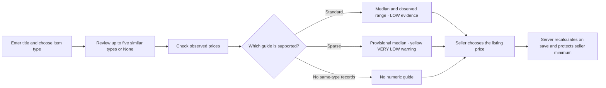

# MoveOn pricing: implementation progress

## Status

| Feature | Status | Decision | Observation-based reason |
|---|---|---|---|
| **1. Initial listing price** | Implemented | Use comparable medians; keep regression out of live guides. | **281/282** holdout items received a numeric guide, including 11 VERY LOW evidence references. Median beat regression on the original same-item comparison. |
| **Item-type suggestions** | Implemented; live semantic quality unmeasured | Show up to five types supported by research or active MoveOn listings, plus **None** for seller confirmation. | Alternate wording can hide a matching type; text similarity does not establish price equivalence. |
| **2. Move-out pricing** | Implemented; 32 focused tests pass | Fixed-window power curve with seller review before applying a recommendation. | Deadline effects and MoveOn sale outcomes have not been evaluated. |
| **3. Bundle discounts** | Implemented; seller approval required | Use a seller-set bundle cap and normal minimum, with a supported historical market gap as the proposed discount. | Bundle outcomes and acceptable discount amounts are unavailable. |

## Seller experience

- A guide can appear **before condition is selected**. Adding condition or brand
  recalculates it. Condition is still required to save a listing.
- The yellow warning states the exact number of reference items and says the
  price may not be reliable. Sparse guides omit a price range. For example,
  **Storage Shelves & Racks** shows a provisional **$24.00** from three items;
  none match Good condition.
- The seller chooses the actual price. The engine does not use that asking
  price to calculate the guide or accept a guide below the seller's minimum.
- A published active MoveOn listing is available as a current asking-price
  comparable for later listings of the same item type. The form excludes the
  listing being edited. Draft and inactive listings are excluded. For live
  references, the server uses same-condition listings when available and one
  recent listing per seller so repeated posts do not dominate the median.
  At least three distinct live sellers are required to replace an available
  historical guide; when the research sample has no guide, even one active
  asking price produces a clearly warned provisional reference. The seller
  still chooses whether to use it, and the server recalculates on save.
  Asking prices are not completed sale prices or verified valuations.

## Pricing rules

| Available comparable evidence | Result |
|---|---|
| At least **8** matching item-type and condition records | Matched median and observed middle-50% range; supported brand/condition adjustment only when its comparison groups also have enough records. |
| At least **10** same-category/type records; condition unselected or New/Like New/Good without a stronger match | Unadjusted item-type median and observed middle-50% range. |
| **1–9** same-type records, or selected Fair/Poor condition with too few matches | Provisional observed median; **VERY LOW** evidence and a yellow count warning. No range or invented condition discount. |
| **0** same-type records | No numeric guide. Semantic similarity alone does not supply a price. |

The table above describes the 2023 research fallback. Active MoveOn listings
can now provide a separate provisional asking-price guide for a type missing
from that sample. New listing types also enter semantic type discovery once
an active listing of that type exists; no CSV edit or model retraining is
required.

The 8- and 10-record cutoffs are **product rules**, not statistical guarantees.
The observed range describes the research prices; it is not a predicted sale
interval. Regression is implemented for analysis but is not used for live guides.

## Validation snapshot

| Measure | Current result |
|---|---:|
| Original research CSV | 1,409 rows; unchanged |
| Eligible prices after cleaning | 1,407 |
| Chronological holdout | 282 items |
| Numeric guides / no guide | 281 / 1 |
| Sparse guides within the 281 | 11 |
| Type-only MAE / condition-aware MAE on 281 items | $21.19 / $21.22 |
| Earlier Phase 1 Django test run | 216 passed, including 31 focused pricing tests |
| Current focused pricing, bundle, messaging, search, and listing regression | 160 passed |
| Dynamic inventory pricing tests | 35 passed, including published painting, source precedence, live median updates, and exclusion of draft/inactive listings |

- **MAE** is average absolute difference from the held-out *observed* price.
  The 11 sparse cases are too few to establish their accuracy, even though
  their observed MAE was $10.75 type-only and $12.48 condition-aware.
- The historical regression comparison used the **previous 12-record policy**
  on the same 268 holdout items: median MAE **$21.72**, regression MAE
  **$25.68**. It has not been rerun for the current sparse-reference policy;
  those numbers must not be compared with the current 281-item MAE.
- The source contains **2023 US-wide observed prices**, not verified sales or
  current UIUC prices. Furniture and Fair/Poor coverage is thin. The semantic
  search cutoff and real model latency have not been evaluated with a labeled
  local set. The full statistical script awaits an environment with NumPy;
  current-policy holdout figures above were computed with Python's standard
  library on the same split.
- The full 323-test run found a bundle checkout fixture that lacked bundle
  eligibility; the fixture was corrected and the focused checkout test passed.
  A separate Windows PNG worker timeout test still fails because its spawned
  child remains alive after the 30-second timeout, including when run alone.
  That worker path was not changed by the pricing integration.

## Next work and details

- Collect local completed-sale outcomes and labeled item-type matches before
  claiming current-market accuracy or promoting another pricing model.
- Phase 2 runs a fixed-window deadline curve. Sellers can accept, decline, or
  modify suggestions; below-normal-minimum prices need separate urgent opt-in.
  Pending recommendations and milestone notices are private to the seller.
- Phase 3 proposes a discount only when the seller opted into bundles, set a
  positive per-item cap and normal minimum, and the historical benchmark has
  LOW evidence. The proposal is the lesser of the gap to the benchmark,
  remaining room above the seller minimum, and the seller cap. VERY LOW or
  missing evidence yields no automatic discount. Every item still requires its
  seller's acceptance. A changed ask, cap, floor, eligibility, or benchmark
  invalidates a pending offer. The bundle item records the price snapshot,
  policy calculation, seller response, and final price; the transaction records
  the agreed price. Savings are measured from the current listed price, which
  already includes any approved move-out markdown.
- Apply migrations through `marketplace.0022_listing_bundle_discount_cap`
  and `bundles.0005_bundleitem_discount_calculation` before using these flows.

## Local pricing walkthrough

1. Run `python manage.py migrate` and start the app with `python manage.py runserver`.
2. Edit an active listing in Seller Listings. Set a move-out date, markdown base,
   normal minimum, and (for the urgent path) an urgent minimum and Sell no matter
   what. Review the resulting suggestion and accept, decline, or modify it.
   Use `python manage.py evaluate_deadline_pricing` to evaluate later days.
3. For bundle discounts, enable bundle participation, set a normal minimum and
   maximum bundle discount, then save. A LOW evidence benchmark below the
   current ask can produce a proposal. Build a bundle with at least three
   eligible items and inspect the itemized prices on the summary page.
4. Send requests. Sign in as each seller and open Messages to inspect and
   accept or decline their proposed item price. A transaction is created only
   upon seller acceptance. Changing a listing price or discount limit after
   the request makes acceptance return a stale-price error.

The historical benchmark is based on 2023 US-wide observations, not current
local completed sales. Bundle proposal amounts and deadline curve parameters
are product rules; neither has measured conversion uplift. The bundle flow has
no cross-seller target discount or LP allocation: the total is exactly the sum
of independently bounded per-item proposals, so no allocation is needed.
- See [implementation notes](implementation_notes.md) for algorithms, files,
  migrations, reproducibility, and test limits; see the
  [regression diagnostics](validation/regression_diagnostics.md) for the
  historical model comparison.
