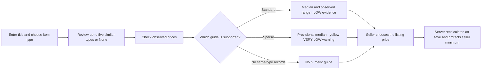

# MoveOn pricing: implementation progress

## Status

| Feature | Status | Decision | Observation-based reason |
|---|---|---|---|
| **1. Initial listing price** | Implemented; 216 tests pass | Use comparable medians; keep regression out of live guides. | **281/282** holdout items received a numeric guide, including 11 VERY LOW evidence references. Median beat regression on the original same-item comparison. |
| **Item-type suggestions** | Implemented; live semantic quality unmeasured | Show up to five research-backed types plus **None** for seller confirmation. | Alternate wording can hide a matching type; text similarity does not establish price equivalence. |
| **2. Move-out pricing** | Not started | Use the Phase 1 benchmark as an input. | Deadline effects and MoveOn sale outcomes have not been evaluated. |
| **3. Bundle discounts** | Not started | Evaluate seller-approved discount limits first. | Bundle outcomes and acceptable discount amounts are unavailable. |

## Seller experience

- A guide can appear **before condition is selected**. Adding condition or brand
  recalculates it. Condition is still required to save a listing.
- The yellow warning states the exact number of reference items and says the
  price may not be reliable. Sparse guides omit a price range. For example,
  **Storage Shelves & Racks** shows a provisional **$24.00** from three items;
  none match Good condition.
- The seller chooses the actual price. The engine does not use that asking
  price to calculate the guide or accept a guide below the seller's minimum.

## Pricing rules

| Available comparable evidence | Result |
|---|---|
| At least **8** matching item-type and condition records | Matched median and observed middle-50% range; supported brand/condition adjustment only when its comparison groups also have enough records. |
| At least **10** same-category/type records; condition unselected or New/Like New/Good without a stronger match | Unadjusted item-type median and observed middle-50% range. |
| **1–9** same-type records, or selected Fair/Poor condition with too few matches | Provisional observed median; **VERY LOW** evidence and a yellow count warning. No range or invented condition discount. |
| **0** same-type records | No numeric guide. Semantic similarity alone does not supply a price. |

The 8- and 10-record cutoffs are **product rules**, not statistical guarantees.
The observed range describes the research prices; it is not a predicted sale
interval. Regression is implemented for analysis but is not used for live guides.

## Validation snapshot

| Measure | Current result |
|---|---:|
| Original research CSV | 1,409 rows; unchanged |
| Eligible prices after cleaning | 1,407 |
| Chronological holdout | 282 items |
| Numeric guides / no guide | 281 / 1 |
| Sparse guides within the 281 | 11 |
| Type-only MAE / condition-aware MAE on 281 items | $21.19 / $21.22 |
| Django tests | 216 passed, including 31 focused pricing tests |

- **MAE** is average absolute difference from the held-out *observed* price.
  The 11 sparse cases are too few to establish their accuracy, even though
  their observed MAE was $10.75 type-only and $12.48 condition-aware.
- The historical regression comparison used the **previous 12-record policy**
  on the same 268 holdout items: median MAE **$21.72**, regression MAE
  **$25.68**. It has not been rerun for the current sparse-reference policy;
  those numbers must not be compared with the current 281-item MAE.
- The source contains **2023 US-wide observed prices**, not verified sales or
  current UIUC prices. Furniture and Fair/Poor coverage is thin. The semantic
  search cutoff and real model latency have not been evaluated with a labeled
  local set. The full statistical script awaits an environment with NumPy;
  current-policy holdout figures above were computed with Python's standard
  library on the same split.

## Next work and details

- Collect local completed-sale outcomes and labeled item-type matches before
  claiming current-market accuracy or promoting another pricing model.
- Phase 2 (move-out pricing) and Phase 3 (bundle discounts) remain untouched.
- See [implementation notes](implementation_notes.md) for algorithms, files,
  migrations, reproducibility, and test limits; see the
  [regression diagnostics](validation/regression_diagnostics.md) for the
  historical model comparison.
