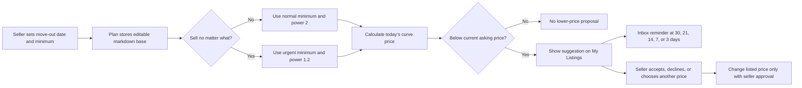
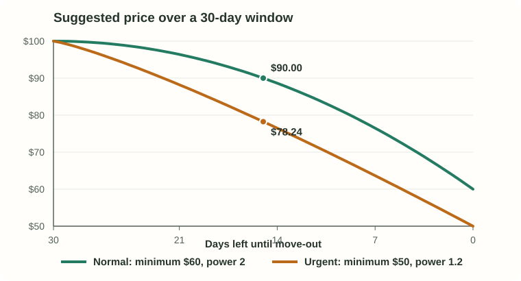
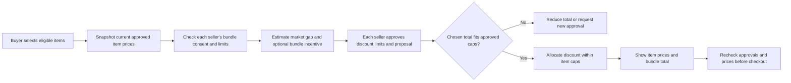

# MoveOn pricing: methods and progress

| Pricing feature | Current method and decision | Alternatives considered and why not selected | Future methods and what they require |
|---|---|---|---|
| **1. Initial listing price** | Same-type historical median guides the seller, who chooses the asking price. | **Attribute-based regression:** had higher error than the median on the same historical holdout. **Fixed depreciation:** ignores differences between item types and markets. | Reassess regression or richer comparable matching after collecting recent **verified UIUC sales**, item details, and labeled type matches; promote a model only if it improves held-out accuracy and coverage. |
| **2. Move-out markdowns** | A bounded power curve proposes lower prices as the deadline approaches; the seller approves each change. | **Linear markdowns:** cannot express the desired late acceleration with one fixed slope. **Demand-optimized pricing:** needs sale probabilities MoveOn cannot yet estimate. | Fit or test curves by item segment, then consider sale-probability-aware pricing; requires exposure, price history, inquiries, offers, completed and unsold outcomes, and controlled comparisons. A host and daily scheduler are needed for exact-day reminders. |
| **3. Bundle discounts** | Planned: propose market-anchored item discounts within each seller's limits, then allocate an agreed total. Bundle selection exists; discount pricing does not. | **Flat percentage for every item:** ignores seller floors and market position. **Buyer-response optimization:** cannot be calibrated without bundle outcomes. | Implement seller-specific consent, floors/caps, quote snapshots, cent-accurate allocation, and revalidation; later estimate useful bundle incentives from views, offers, accepted quotes, sales, and seller proceeds. |

The bundle builder can select items today; it does **not** yet calculate the Feature 3 discounts described below. A market benchmark, a proposed price, and a seller-approved price are different things. See the [technical strategy](PRICING_STRATEGY.md) for implementation details.

## Feature 1 — Initial listing price guide

**Logic summary**

- **UC1: When "Item Type" and "Condition" are available:** If there are **8 or more** historical records matching both fields, the recommended price is their median. When enough same-brand records exist, the guide can use that closer match. Eight is a temporary threshold, not a guarantee that the price will sell.

- **UC2: When "Item Type" ONLY is Available, there are three possibilities:**

  1. When there are >=10 matching records based on "Item Type" : The recommended price uses the "item type" median confidently.
  2. When there are <10 matching records based on "Item Type" :  The median recommended price is still shown but with a warning message indicating VERY LOW evidence and the item count of which the price is based on.
  3. With no same-type records: It shows no price guide.

  Here, "confidently" means the guide passes the temporary record-count rule; its displayed evidence grade is still **LOW** because the source is old and not verified as completed sales. If Fair or Poor condition is selected but has too few close matches, MoveOn shows a provisional guide even when the broader item type has at least 10 records.

- **UC3: When the entered item may match another item type:** MoveOn compares the listing title with item types backed by historical records and shows up to **five** similar types. The seller can select one to see its price guide or choose **None** to keep the item type they entered. If that original type has matching records, its guide can still appear; otherwise MoveOn shows no numeric guide. The similarity search helps the seller choose a type but does not calculate the price.

**How the guide works**

- Match the seller-confirmed category and item type to historical observations. A guide can appear before condition is chosen; condition and brand can refine it. Similar title wording helps find an item type but never supplies a price by itself.
- **Guide = median of selected comparable prices.** The median is the middle observed price. When evidence is sufficient, the displayed range is the middle 50% of *observed* prices, not a predicted selling range.
- The seller sets the final asking price. Their chosen price does not feed back into the market median, and a guide cannot undercut their minimum.

| Comparable evidence | What MoveOn shows |
|---|---|
| At least **8** same-type, same-condition observations, including a supported brand match when available | Matched median and observed middle-50% range; a condition adjustment is used only when both comparison groups have enough records. |
| At least **10** same-type observations, with no stronger match and a supported condition or no condition yet | Unadjusted item-type median and observed middle-50% range. |
| **1–9** same-type observations, or a selected Fair/Poor condition with too few close matches | Provisional median, **VERY LOW** evidence warning, and comparable count; no range or invented condition discount. |
| No same-type observations | No numeric guide; the seller enters a price. |

- The 8- and 10-record cutoffs are product rules, not guarantees of accuracy. For example, **Storage Shelves & Racks** has a provisional **$24** guide from three observations; none match Good condition.

**Evaluation snapshot**

| Measure | Observed result |
|---|---:|
| Original research rows / eligible after cleaning | 1,409 / 1,407 |
| Chronological holdout items | 282 |
| Numeric guides / no guide | 281 / 1 |
| Sparse guides within the 281 | 11 |
| Type-only / condition-aware mean absolute error on 281 items | $21.19 / $21.22 |

- Mean absolute error is the average distance from the held-out *observed* price, not from a verified sale price.
- In an earlier same-item comparison using a different coverage rule, median MAE was **$21.72** versus **$25.68** for regression on **268** items. Those results explain why the live guide uses medians; they are not directly comparable with the 281-item results. [Evaluation details](validation/phase1_evaluation.json).
- [Rosen's hedonic-price research](https://doi.org/10.1086/260169) explains why item attributes can affect value. [eBay Product Research](https://www.ebay.com/help/selling/selling-tools/research?id=4853) is a real-world example of filtering historical *sold* prices by condition, brand, and location. MoveOn's source has not been verified as sold-price data, so its guide is a historical price reference rather than an established local sale value.

**Current limitations**

- The 2023 US-wide source is old for a UIUC marketplace. Furniture and Fair/Poor examples are scarce; all supported live guides are labeled LOW evidence or VERY LOW for sparse cases.
- The observed range measures source-price spread, not the chance of selling within that range. Item-type suggestion quality has not been measured against a labeled local set.

**Recommended improvements and what they require**

- Replace or supplement the source with **recent, verified local completed sales**, including date, item type, condition, brand, realized price, and pickup context. Keep unsold listings separately so the model does not learn from sales alone.
- Label local item-title/type matches and measure guide error by type and condition. Reconsider regression only if it beats the median on the **same held-out items** and provides reliable coverage.

## Feature 2 — Move-out markdown suggestions

**Logic summary**

- **UC1 — Set up the plan:** The seller supplies a move-out date and normal minimum. MoveOn fills the editable markdown base from the original listing price. A plan started inside the final 30 days uses the 30-day reference window so today's suggestion reflects days remaining.
- **UC2 — Choose normal or urgent curve:** Normal uses the normal minimum and power **2**. **Sell no matter what** requires a seller-chosen Urgent Minimum and uses power **1.2**. Changes to these inputs recalculate the target; only editing the markdown-base field changes the base.
- **UC3 — Decide on today's proposal:** Show a suggestion only when the calculated target is below the current asking price. The seller can request it on My Listings any day; milestone days **30, 21, 14, 7, and 3** can also create an inbox reminder when a lower proposal exists. Accepting or modifying a price requires seller action, with separate approval below the normal minimum; declining leaves the listed price alone.

### How move-out markdowns work

For any day in the plan:

> **Markdown = (base price − chosen minimum) × (elapsed days ÷ plan days) raised to curve power**
>
> **Suggested price = base price − markdown**

- **Base price (P):** The editable **Move Out Deadline Markdown Base Price** starts at the original listing price. Accepted markdowns and ordinary asking-price edits leave it alone; editing this field directly recalculates the curve. It is the reference price for suggested automated markdowns approaching move-out, intended to improve the chance of a sale. It stays at its original value unless the seller changes it.
- **Chosen minimum (F):** The normal minimum for a regular plan; the separate **Urgent Minimum** when **Sell no matter what** is on. The urgent minimum can be lower than the normal one but must be chosen by the seller.
- **Plan days (T)** and **elapsed days (e):** The window from the plan's reference start to move-out, and the days passed in that window. A plan started with fewer than 30 days left uses a 30-day reference window; that reference date does not claim the item was listed earlier.
- **Curve power (γ):** Controls timing. Normal uses **2**, saving larger reductions for later. Urgent uses **1.2**, suggesting larger reductions earlier. These are pilot product choices, not research-proven optima. The formula is a **power curve**, not an exponential curve.

**Example:** A $100 base, 30-day window, $60 normal minimum, and $50 urgent minimum produce:

| Days left | Normal, power 2 | Sell no matter what, power 1.2 |
|---:|---:|---:|
| 30 | $100.00 | $100.00 |
| 15 | $90.00 | $78.24 |
| 0 | $60.00 | $50.00 |

- MoveOn proposes a markdown only when the curve price is **below the current asking price**. Changing the asking price, either minimum, the base, move-out date, or urgency recalculates future proposals. Extending the date does not automatically raise the current listed price.
- The seller can request a suggestion on **My Listings** on any day. The MoveOn inbox gives milestone reminders at **30, 21, 14, 7, and 3 days left** when a lower proposal exists. A deployed daily scheduler is still required for reliable exact-day reminders; editing pricing settings also checks today's milestone.
- Every listed-price reduction requires seller action. A reduction below the normal minimum needs **separate approval** and may never pass the urgent minimum. “Sell no matter what” signals greater willingness to reduce price; it cannot guarantee a buyer.
- [Gallego and van Ryzin](https://doi.org/10.1287/mnsc.40.8.999) study pricing inventory within a finite selling window and cite seasonal retail and travel capacity as examples. Their result supports accounting for a deadline, **not** MoveOn's particular curve or power values.

**Current limitations**

- The curve does not estimate demand, sale probability, or the highest price likely to sell by move-out. The fixed powers may reduce value too quickly or too slowly for different items.
- Exact-day inbox reminders depend on a scheduler that has not been configured for a host. Some older listings received a base from the current asking price because their original price was not retained; sellers should review that field.

**Recommended improvements and what they require**

- Record listing exposure and views, price history, inquiries, offers, completed sales, unsold outcomes, move-out dates, pickup flexibility, and seller decisions. Compare normal and urgent curves by category on held-out data or through controlled experiments before tuning powers.
- Add a reliable daily job after hosting is chosen. Add a separate final-day pickup or donation workflow for sellers whose main goal is removal, because price alone cannot ensure it.

## Feature 3 — Bundle discount recommendations

**Status: planned.** Bundle selection exists, but the following pricing policy and per-seller approval workflow still need implementation.

**Logic summary — proposed Feature 3 behavior**

- **UC1 — Select eligible items:** The buyer assembles a bundle. Take a snapshot of each item's current listed price, which already reflects any accepted move-out markdown.
- **UC2 — Determine each seller's room to discount:** Check bundle consent, the seller's authorized floor and any bundle-specific cap. If the market benchmark has adequate evidence, use the amount above it as a possible alignment discount. A separate bundle incentive needs the seller's authorization; urgency alone does not authorize it.
- **UC3 — Set and allocate a bundle discount:** Obtain each seller's approved limits or exact quote. Choose a total no larger than the sum of approved capacities, allocate it across items within those limits, and ask again if a final item amount differs from an exact quote.
- **UC4 — Present and confirm:** Show itemized prices and seller proceeds. Recheck listing availability, current prices, and approvals before checkout; reduce or withdraw a quote if the approved terms no longer hold.

**Proposed method**

- Start from each item's **current approved asking price**. This already includes any accepted move-out markdown, so a bundle proposal must add only a *new* discount.
- For item *i*, let **L** be its current asking price, **M** a reliable market benchmark, **F** its seller-authorized bundle floor, and **C** any separate bundle discount cap. The maximum extra discount is **U = min(max(0, L − F), C)** when a cap exists. With no cap, use the floor-based amount only if the seller has explicitly approved that bundle rule; otherwise offer no automatic discount. An urgent markdown floor is not automatically bundle authorization.
- **Market gap = max(0, L − M)** when M has adequate evidence. A conservative market-alignment proposal is the smaller of this gap and U. A seller may separately approve an extra bundle incentive, still within U. A market gap suggests room to reduce a price; it does not prove the discount will cause a sale.
- If sellers agree on a bundle-wide discount **D**, allocate item discounts **d** so **sum of d = D** and **each d is between 0 and its item cap U**. D must be no more than the sum of approved caps. Final item amounts that differ from an approved exact quote need fresh approval. A linear program can distribute a feasible D according to explicit seller preferences; for simple cases, a transparent capped allocation is sufficient. Neither method discovers the best D without buyer-response evidence.
- Example: A **$100 desk** with a $90 benchmark and $80 floor has a $10 market gap and $20 floor-based capacity. A **$40 chair** with a $42 benchmark and $35 floor has no market gap but could receive a separately approved $3 incentive. A **$30 lamp** with a $25 benchmark and $20 floor has a $5 gap. A possible $18 bundle discount is **$10 + $3 + $5**, subject to each seller's consent and limits. These amounts are illustrative, not measured optima.
- [eBay's Bundle Discounts](https://www.ebay.com/sellercenter/growth/seller-hub-discounts/bundle-discounts) illustrate seller-controlled multi-item incentives. MoveOn can combine items from **different sellers**, so each person's approval matters. [SciPy's linear programming documentation](https://docs.scipy.org/doc/scipy/reference/generated/scipy.optimize.linprog.html) describes the tool for allocating a specified feasible discount; it supplies no demand or conversion estimate.

**Current limitations**

- MoveOn has not implemented bundle discount calculations, cross-seller approvals, or item-level discount allocation. The current benchmark may be too weak to justify a market-gap proposal.
- There is no observed bundle demand or evidence of an optimal discount size. Seller-approved caps and floors constrain what is allowed; they do not show what buyers will accept.

**Recommended improvements and what they require**

- First implement explicit per-seller bundle consent, floors and caps; quote snapshots; approval records; cent-accurate allocation; and revalidation when listings, prices, or availability change. Show each seller's proceeds and the buyer's itemized total before commitment.
- Record bundle views, offers, accepted and rejected quotes, completed sales, seller proceeds, and time-to-sale. Use these outcomes, ideally with controlled comparisons, to estimate whether an added bundle discount increases completed transactions enough to justify its cost.
